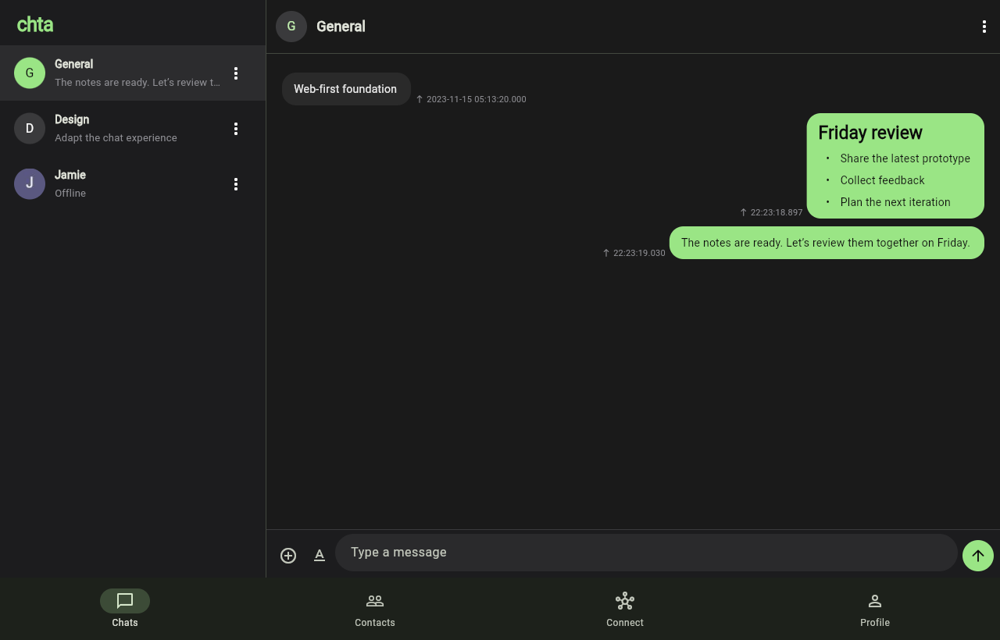
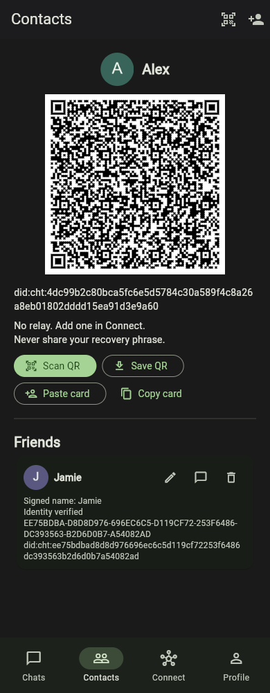
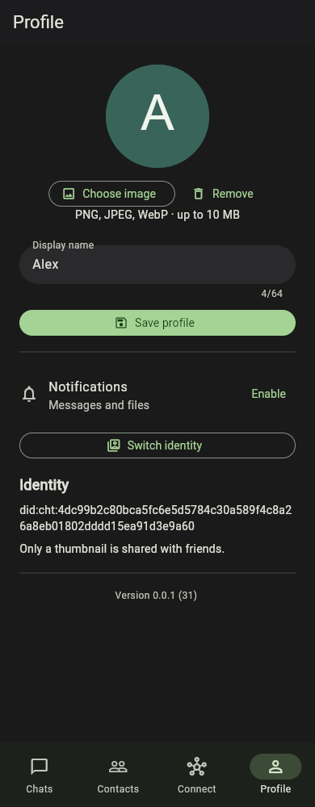

# chta

Peer-to-peer chat for Web, Windows and Android. Send encrypted messages, share files and create private groups. The interface uses Flutter, with a shared Rust core compiled for browsers and native apps.

[Try the Web app](https://chta.app/chat/) · [Releases](https://github.com/usero2/chta/releases) · [Getting started](https://chta.app/#start) · [MIT License](LICENSE)

> This repository now contains an experimental identity, contact, WebRTC, and Noise-encrypted 1:1 path. It has not been independently audited and is not production-ready.

## A look around



| Contacts and QR sharing | Profile and identities |
| --- | --- |
|  |  |

Captured from the Web app at desktop and phone sizes using sample identities and local conversation data. No personal conversations are included.

## Platforms

Windows x64, Android ARM64 and Web have preview builds. The other desktop targets below are planned; they do not have working chta packages yet.

| Platform | Architecture | Status and intended distribution |
| --- | --- | --- |
| Web | Supported desktop and mobile browsers | Preview · [Open chat](https://chta.app/chat/), Rust/WASM |
| Windows | x64 | Preview · single-file `chta.exe`; portable ZIP and MSI planned |
| Windows | ARM64 | Planned · single EXE, portable ZIP and MSI |
| macOS | Apple Silicon and Intel | Planned · universal DMG |
| Linux | x86_64 and ARM64 | Planned · AppImage, DEB, RPM, Flatpak, Arch package and TAR |
| Linux | RISC-V 64-bit | Planned · DEB, RPM and TAR; requires additional runtime work |
| FreeBSD | x86_64 and ARM64 | Planned · TAR; requires additional runtime work |
| Android | ARM64 | Preview · APK |

See the [release distribution plan](docs/superpowers/specs/2026-11-15-public-release-design.md) for the target matrix and acceptance checks. Packages will be listed in [GitHub Releases](https://github.com/usero2/chta/releases) when published. The repository is currently private, so GitHub access is required.

## Current capabilities

- Responsive two-pane desktop and single-pane mobile chat layout.
- Chat selection and text sending through Rust/WASM commands.
- Versioned room/message persistence in browser IndexedDB across reloads.
- Explicit rejection of empty messages and unknown conversations.
- Rust core models with deterministic ordering and unit tests.
- A typed, versioned JSON boundary between Flutter Web and Rust/WASM.
- Flutter controller and widget tests.
- BIP-39 identity creation, confirmation, encrypted browser persistence, and restore.
- Signed QR contact cards with user-chosen display names, fingerprint verification, and add/remove operations.
- Persistent Web/Desktop profiles with a `/profile` route, display name, and automatically cropped 256×256 avatar.
- Signed compact avatar thumbnails shared through contact cards, displayed in Contacts and Chats and cached for offline use.
- Windows saved identity picker and PIN login after one-time recovery/create setup, with encrypted identity storage and separate profiles, contacts and local rooms. See [Desktop login](docs/desktop-login.md).
- Six-digit room-code signaling for WebRTC DataChannel setup, with automatic offer/answer exchange and configurable STUN.
- Authenticated Noise KK messaging with Pending, Sent, Delivered, Failed, retry, and active-session duplicate detection.
- Refresh-safe Web routes for Chats, Contacts, Connect, Profile, individual conversations, and selected friends.
- Windows Desktop runner with a native Rust FFI bridge for identity, contacts, and local chat commands.
- Native Windows node service powered by `rust-libp2p`, with TCP listening, Noise/Yamux transport security, LAN discovery through mDNS, and optional Circuit Relay v2 service.
- Standalone Rust `cht-relay` server with encrypted persistent Peer ID, fixed TCP port, connection/circuit limits and a Linux systemd installer. See [public relay setup](docs/relay-server.md).
- Signed relay catalogs shared across nodes, cached discovery and automatic failover with an ordered Noise-encrypted WebSocket chat path on Web, Android and Desktop. Windows can create and supervise a TryCloudflare public relay from Connect. See [relay mesh setup and limits](docs/relay-mesh.md).
- Automatic same-computer WASM-to-Desktop chat through a localhost-only WebSocket companion; verified contacts no longer need room-code Invite/Join for this path.
- A shared Chats sidebar for local rooms and friends, with encrypted per-identity friend history on Web and Windows, including offline viewing.
- Android ARM64 preview with native Rust identities, PIN login, encrypted history, profile images, QR contacts and a USB connection to the Desktop companion. See [Android setup and limits](docs/android.md).

## Repository layout

```text
apps/flutter_app/       Shared Flutter Web, Windows and Android application
rust/crates/core/       Rust chat domain with WASM and native FFI exports
rust/crates/native_mesh/ Standalone native libp2p listener and relay DLL
rust/crates/relay_server/ Headless TCP Circuit Relay v2 and cht WebSocket relay
rust/crates/relay_protocol/ Shared signed relay records and registration proof
deploy/relay/           Relay configuration, systemd unit and installer
scripts/                Local build helpers
docs/                   Architecture and migration records
assets/branding/        Shared app icon source
```

## Prerequisites

The first verified environment used:

- Flutter 3.47.9 / Dart 3.13.7
- Rust 1.99.1
- `wasm32-unknown-unknown`
- `wasm-bindgen-cli` 0.2.130
- Chrome 146

Install Flutter from the stable channel and Rust through `rustup`. Then add the WASM target and matching CLI:

```powershell
rustup target add wasm32-unknown-unknown
cargo install wasm-bindgen-cli --version 0.2.130 --locked
```

## Build and run

Launcher icons for Android, Windows and Web use `assets/branding/chta-icon.png`, with transparent rounded corners and no white border. Regenerate the committed platform assets from `apps/flutter_app` with `dart run flutter_launcher_icons`; settings are in `flutter_launcher_icons.yaml`.

From the repository root:

```powershell
powershell -ExecutionPolicy Bypass -File scripts/build-web-core.ps1
Set-Location apps/flutter_app
flutter pub get
flutter build web --release --pwa-strategy=none
Set-Location ..\..
python scripts/dev_server.py --port 7357
```

Open `http://localhost:7357`. The development server hosts the Web build, disables browser caching, and keeps signaling rooms in memory for ten minutes. The Rust/WASM build must run before Flutter Web because generated browser bindings are intentionally ignored by Git.

For the Windows Desktop preview:

```powershell
Set-Location apps/flutter_app
flutter build windows --release
.\build\windows\x64\runner\Release\chta.exe
```

The Windows build compiles and bundles `cht_core.dll`, `cht_mesh.dll` and `cht-relay.exe` automatically. After identity unlock, every Desktop starts its native LAN listener and Circuit Relay v2 service. **Connect → Stop listening** stops the LAN service for the current session. For Internet chat, enable **Public relay through TryCloudflare** in Connect and share its URL; the app creates/supervises the tunnel and remembers this setting. See [relay mesh](docs/relay-mesh.md). Native TCP listening and its optional PIN are separate from the public WebSocket service.

In `0.0.1+13`, contact cards/QRs include up to two signed public relay URLs.
**Add friend & chat** imports the route after fingerprint confirmation; an unknown
sender requires **Review** approval on the recipient. All clients can set a saved
relay connection target of 50–1000 (default 50, at most six pending handshakes).
Android activity recreation now returns to the saved identity/PIN picker instead
of hanging on the splash; see [startup regression](docs/android-startup.md).

Windows identities, profiles and contacts persist locally and unlock with a PIN. The native listener/relay foundation is operational; the application-level direct-chat protocol and DID/PIN handshake over libp2p are still separate from the companion chat path and must be completed before Desktop-to-Desktop messages are production-ready.

For Android, follow [the build and chat instructions](docs/android.md). Internet chat uses a reachable shared WebSocket relay; USB companion remains an optional local testing path. Standalone Android hosting, LAN discovery and background wake-up are not implemented yet.

## Private groups and chat actions

Use **＋** beside **chta** to create a group with verified friends. Invitations require acceptance; the owner must be online to finalize membership. Groups support up to 16 members, including the owner.

Members exchange encrypted messages and verified file pieces with each other. A partial download can serve its verified pieces to other members. Files larger than 25 MiB wait for a Direct connection; the Direct limit is 10 GiB per file. The public seed at `chta.app/relay` carries signed connection setup data, never chat or file content.

On mobile, tap **⋮** beside a friend or group in Chats, or hold the row, to view details or clear local chat history. Clearing history keeps the friend or group membership. Verified friends can establish WebRTC while the receiving app is open on another page. Some networks still require a reachable content relay when Direct cannot connect.

Unavailable relays are removed after seven days of recorded failure. Lock a relay in **Connect → Relays** to keep it until you remove it yourself.

## Verify

```powershell
cargo fmt --all -- --check
cargo clippy --workspace --all-targets -- -D warnings
cargo test --workspace
cargo build -p cht-core --target wasm32-unknown-unknown
cargo test --manifest-path rust/crates/native_mesh/Cargo.toml
powershell -ExecutionPolicy Bypass -File scripts/build-web-core.ps1

Set-Location apps/flutter_app
flutter analyze
flutter test
flutter build web --release --pwa-strategy=none
flutter build windows --release

Set-Location ..\..
python -m unittest scripts.test_dev_server -v
```

## Reference project

The layout and interactions were informed by an earlier chat prototype. Its backend, storage and private configuration are not included in this repository.

See [the migration record](docs/migrations/mine-chat-note-webchat.md) for the exact mapping.

## License

chta is licensed under the [MIT License](LICENSE). Third-party dependencies retain their own licenses.
